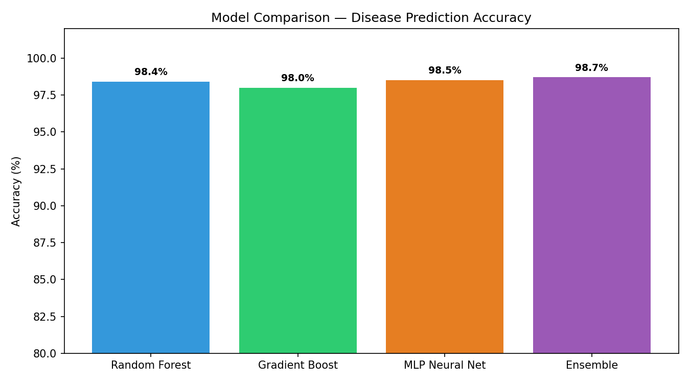
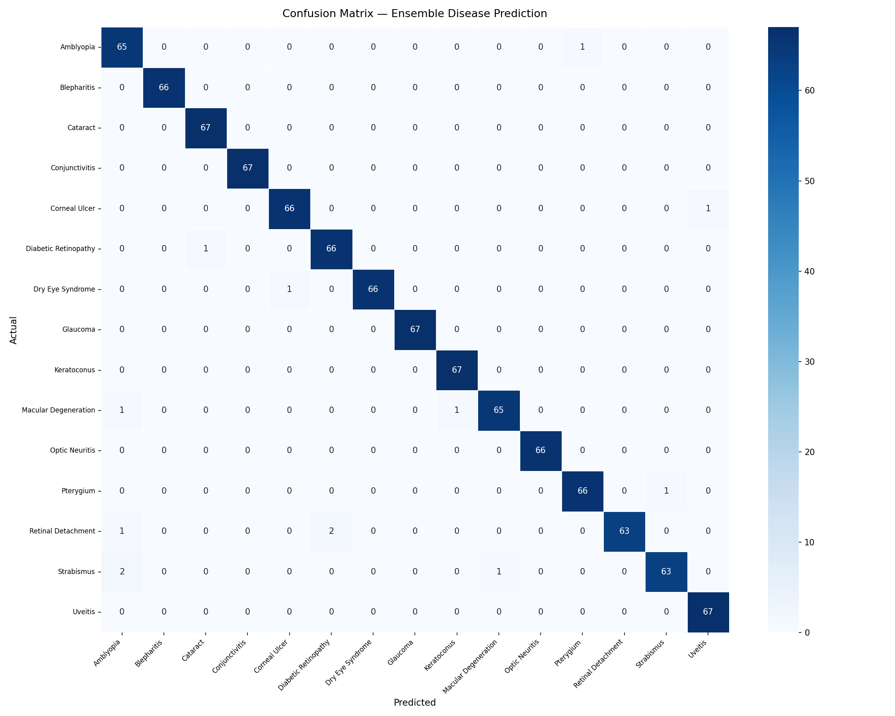
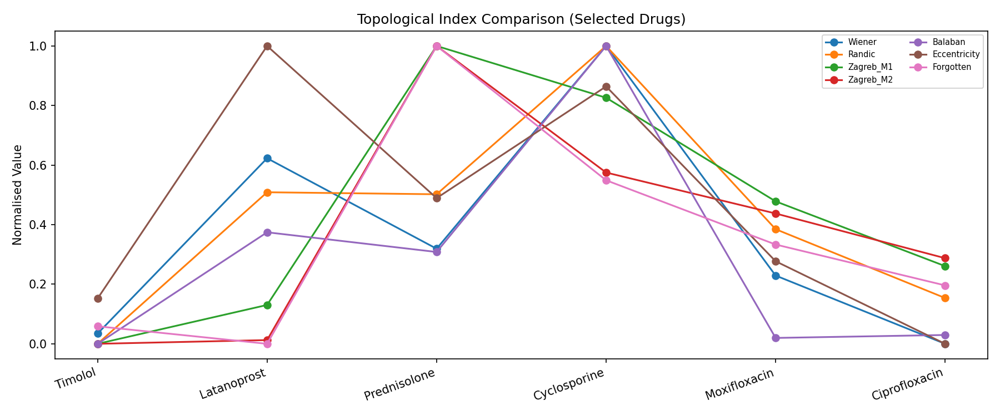
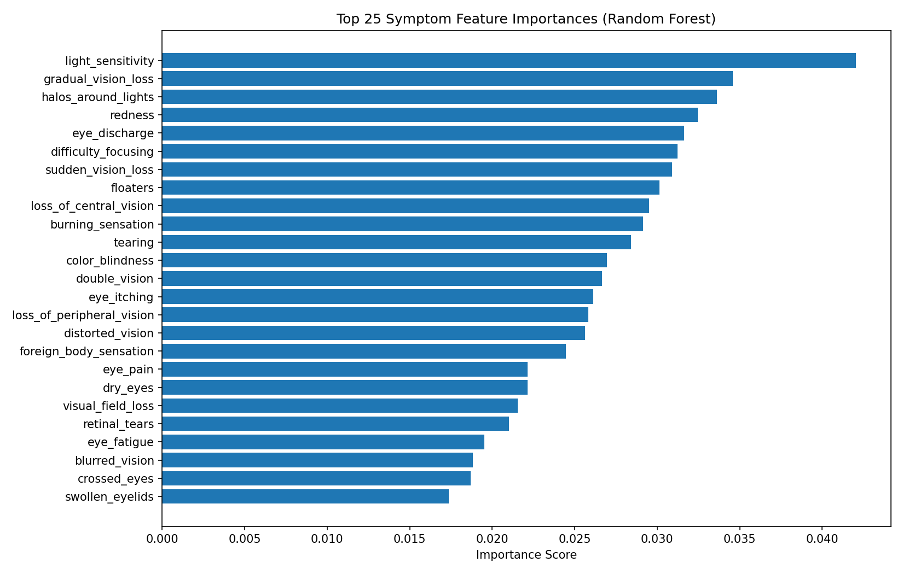

# VisionCheck — Eye Disease Predictor

Predicts likely eye diseases from a list of symptoms, then recommends drugs and foods for the predicted disease.
Disease prediction uses an ensemble of machine-learning models. Drug recommendation uses **graph-theoretic
topological indices** computed from each drug's molecular structure (SMILES → molecular graph).

> ⚠️ **Academic project — not medical advice.** Predictions and recommendations are for learning purposes only.
> Always consult a qualified ophthalmologist.

## Features

- **15 eye diseases** — Glaucoma, Cataract, Diabetic Retinopathy, Macular Degeneration, Conjunctivitis,
  Dry Eye Syndrome, Uveitis, Retinal Detachment, Amblyopia, Strabismus, Keratoconus, Corneal Ulcer,
  Blepharitis, Pterygium, Optic Neuritis
- **Disease prediction** — weighted soft-voting ensemble of Random Forest, Gradient Boosting and an MLP neural network
  (plus XGBoost when installed), with severity-weighted symptom features
- **Drug recommendation** — 30 ophthalmic drugs converted from SMILES into molecular graphs; an MLP ranks them using
  topological indices:
  Wiener, Randić, Zagreb M1/M2, Forgotten, Balaban J, eccentric connectivity, and the top adjacency-matrix eigenvalues
- **Diet recommendation** — top eye-health foods scored per disease
- **VisionCheck web app** (`index.html`) — a standalone browser UI with the trained Random Forest exported to
  JavaScript, so it runs fully offline with no server

## Results

Disease-prediction accuracy on a 20% hold-out set (figures vary by about ±0.5% between runs, because the synthetic
data is regenerated each time):

| Model | Accuracy |
|---|---|
| Random Forest | 98.4% |
| Gradient Boosting | 98.0% |
| MLP Neural Net | 98.5% |
| **Ensemble** | **98.2–98.7%** |

5-fold cross-validation (Random Forest): **98.9% ± 0.4%**. Drug-recommendation MLP: **87.8% accuracy**.

<p align="center">
  
  
</p>
<p align="center">
  
  
</p>

## Getting started

```bash
git clone https://github.com/<your-username>/visioncheck-eye-disease-predictor.git
cd visioncheck-eye-disease-predictor
pip install -r requirements.txt
python eye_disease_system.py
```

The script trains the models, saves evaluation charts as PNGs in the current folder, and then asks for symptoms
interactively (for example `blurred_vision, eye_pain, redness`). Press Enter on an empty line to quit.

To use the web app, open `index.html` in any browser. It can also be hosted with GitHub Pages
(**Settings → Pages → Deploy from branch → `main` / root**).

## Project structure

```
├── eye_disease_system.py     # Training, topological indices, prediction CLI, plots
├── index.html                # VisionCheck web app (model embedded in JS)
├── dataset.csv               # Disease → symptom records (Kaggle)
├── Symptom-severity.csv      # Symptom severity weights (Kaggle)
├── images/                   # Sample output charts
└── requirements.txt
```

## Data

- **Training data:** synthetic patient records (5,000 rows, 15 diseases), generated from clinical symptom profiles
  for each disease, with random symptom dropout and noise symptoms to mimic real presentations.
- **Kaggle files:** the script also loads `dataset.csv` and `Symptom-severity.csv` from the
  [Disease Symptom Description Dataset](https://www.kaggle.com/datasets/itachi9604/disease-symptom-description-dataset)
  by itachi9604. That dataset covers general diseases, and **none of its symptoms match the eye-symptom vocabulary**,
  so it currently contributes no training rows, and the built-in severity weights are used instead. Adding a real
  eye-disease dataset is the main next step.
- **Drug structures (SMILES):** [PubChem](https://pubchem.ncbi.nlm.nih.gov/)
- **Drug indications:** [DrugBank](https://go.drugbank.com/)

## Tech stack

Python · scikit-learn · XGBoost · NetworkX · RDKit (optional) · pandas · Matplotlib · Seaborn · HTML/CSS/JavaScript
